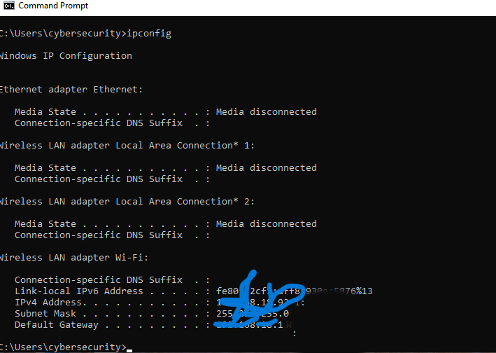
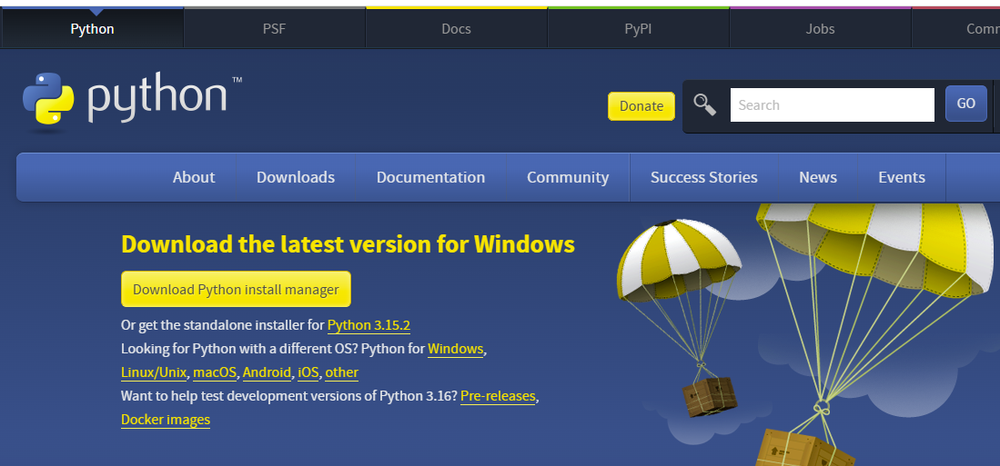
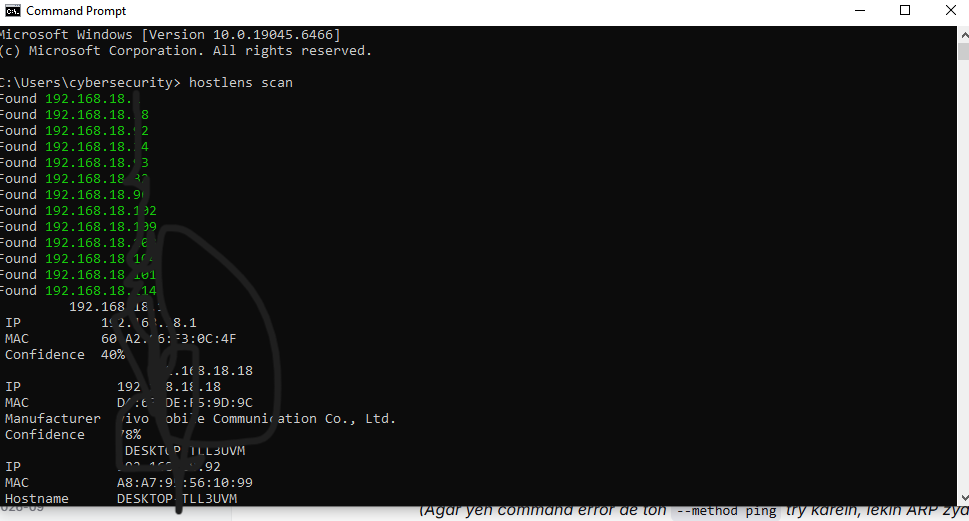
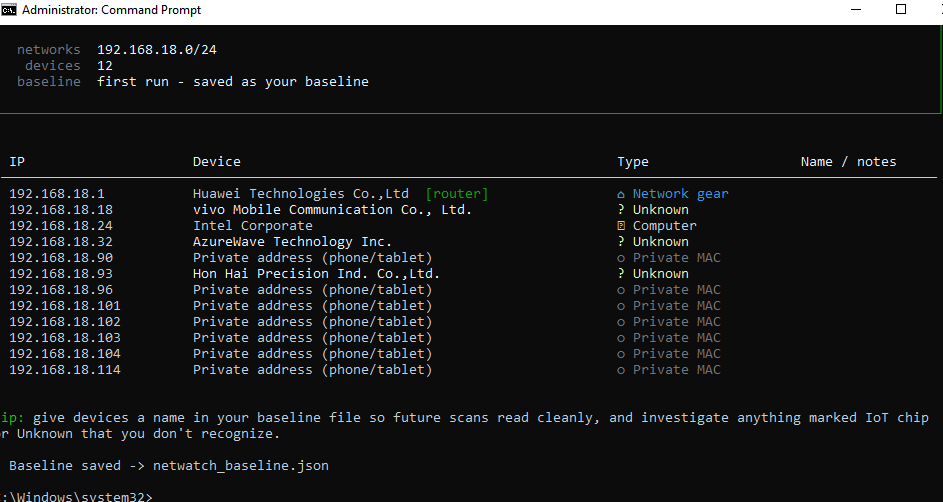
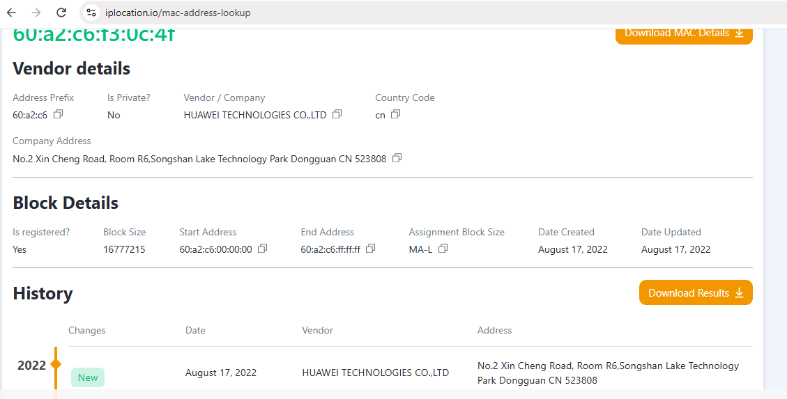

<h1 align="center">⚙️ Implementation & Evidence</h1>

<i>Step-by-Step Execution of Network Device Identification</i>

---

## Phase 1: Identifying Local Network
First, I identified my local IP and subnet using the Windows Command Prompt.

*   **Command Used:** `ipconfig`
*   **Result:** The local IP was `192.168.18.92` and the default gateway was `192.168.18.1`.

**Evidence (ipconfig Output):**

---

## Phase 2: Active Scanning with Zenmap (Nmap)
I used Zenmap (Nmap GUI) to perform a Ping Scan on the subnet `192.168.18.0/24` to find live hosts.

*   **Result:** Found 12 active hosts. Some had known MAC addresses (Huawei, Vivo), while others showed as "Unknown".

**Evidence (Zenmap Ping Scan):**

---

## Phase 3: OS Fingerprinting on Unknown Device
I targeted an unknown device (`192.168.18.90`) with an aggressive Nmap scan to find its OS and open ports.

*   **Command Used:** `nmap -sS -O --script smb-os-discovery 192.168.18.90`
*   **Result:** All 1000 scanned ports were closed. Nmap guessed it as a phone in sleep mode due to the randomized MAC address (`92:84:7F...`).

**Evidence (Nmap Aggressive Scan):**

---

## Phase 4: MAC Vendor Lookup
To confirm the router's identity, I extracted its MAC address (`60:A2:C6:F3:0C:4F`) and checked it on an online OUI lookup tool.

*   **Result:** Confirmed it belongs to **Huawei Technologies**.

**Evidence (MAC Lookup on IPLocation.io):**

---

## Phase 5: Python-Based Identification (HostLens & Netwatchdog)
To automate the process and get better results, I installed Python and used Python-based scripts.

**1. Python Installation:**

**2. Installing HostLens Tool:**
*   **Command Used:** `pip install hostlens`

**Evidence (CMD Installation):**

**3. Running HostLens Scan:**
*   **Command Used:** `hostlens scan`
*   **Result:** Successfully identified the Hostname of `192.168.18.92` as `DESKTOP-TLL3UVM`.

**Evidence (HostLens Output):**

**Evidence (Zenmap Intense Scan):**

**4. Running Netwatchdog (Baseline Scan):**
*   **Command Used:** `netwatchdog` *(Run as Administrator)*
*   **Result:** Clearly segregated devices into categories: Router, Computer, and **Private MAC (phone/tablet)**.

**Evidence (Netwatchdog Output):**

**Evidence (MAC Lookup):**

---

## Conclusion
Through this project, I successfully mapped out my entire local network. I discovered that while Nmap and Python scripts are powerful for identifying computers and routers, identifying modern smartphones is almost impossible without router admin access due to **MAC Randomization**. This project highlighted the importance of passive reconnaissance (like Wireshark DHCP sniffing) over active scanning for privacy-focused devices.
