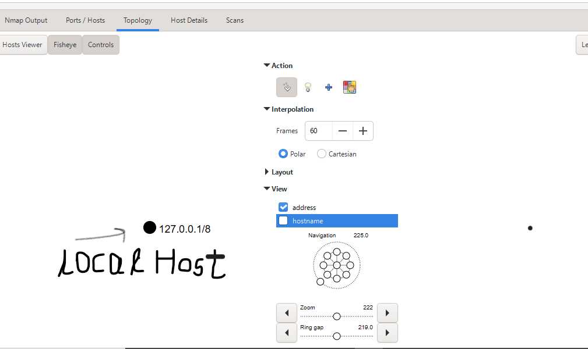

<p align="center">
  
</p>

<h1 align="center" style="color: #2c3e50; font-family: 'Segoe UI', Tahoma, Geneva, Verdana, sans-serif;">🌐 Network Device Identification & Enumeration</h1>

<p align="center" style="font-size: 1.1em; color: #34495e;">
  <b>An Educational Project for Local Network Reconnaissance & Analysis</b>
</p>

<br>

<!-- Author Details Card -->
<div style="background: linear-gradient(135deg, #1e3c72 0%, #2a5298 100%); border-radius: 12px; padding: 20px; color: white; box-shadow: 0 4px 8px rgba(0,0,0,0.2); margin-bottom: 25px;">
  <h3 style="margin-top: 0; color: #ecf0f1; border-bottom: 2px solid rgba(255,255,255,0.2); padding-bottom: 10px;">👨‍💻 Project Details</h3>
  <p style="margin: 8px 0;"><b>Author:</b> Muhammad Ayaz</p>
  <p style="margin: 8px 0;"><b>Program:</b> Cyber Security B084H</p>
  <p style="margin: 8px 0;"><b>Instructor:</b> Mr. Waqas Karim</p>
</div>

<!-- Objective Card -->
<div style="background-color: #f8f9fa; border-left: 6px solid #e74c3c; border-radius: 8px; padding: 15px; margin-bottom: 25px; box-shadow: 0 2px 5px rgba(0,0,0,0.1);">
  <h3 style="margin-top: 0; color: #c0392b;">🎯 Objective</h3>
  <p style="margin-bottom: 0; color: #2c3e50;">To identify unknown devices on a local network using active and passive reconnaissance techniques.</p>
</div>

<!-- Tools Card -->
<div style="background-color: #f8f9fa; border-left: 6px solid #3498db; border-radius: 8px; padding: 15px; margin-bottom: 30px; box-shadow: 0 2px 5px rgba(0,0,0,0.1);">
  <h3 style="margin-top: 0; color: #2980b9;">🛠️ Tools Used</h3>
  <span style="background-color: #3498db; color: white; padding: 5px 10px; border-radius: 20px; font-size: 0.9em; margin-right: 5px;">Nmap</span>
  <span style="background-color: #3498db; color: white; padding: 5px 10px; border-radius: 20px; font-size: 0.9em; margin-right: 5px;">Zenmap</span>
  <span style="background-color: #3498db; color: white; padding: 5px 10px; border-radius: 20px; font-size: 0.9em; margin-right: 5px;">Python (HostLens)</span>
  <span style="background-color: #3498db; color: white; padding: 5px 10px; border-radius: 20px; font-size: 0.9em;">Wireshark</span>
</div>

---

<h2 style="color: #2c3e50; border-bottom: 2px solid #bdc3c7; padding-bottom: 10px;">📖 Project Introduction</h2>
<p>In modern networks, identifying connected devices is crucial for security. However, with the introduction of <b>MAC Randomization</b> in iOS and Android devices, identifying unknown devices has become challenging. This project documents the step-by-step process of discovering live hosts, identifying their operating systems, and attempting to unmask devices using random MAC addresses.</p>

<h2 style="color: #2c3e50; border-bottom: 2px solid #bdc3c7; padding-bottom: 10px;">⚠️ Problem Statement</h2>
<p>During a local network scan, several devices appear as "Unknown" because modern smartphones hide their true MAC addresses for privacy. Traditional tools like Nmap can only see the random MAC and closed ports. The challenge is to bypass this limitation and identify the device types using advanced enumeration.</p>

## 3. Objectives & Scope
*   **Objective 1:** Discover all active hosts on the `192.168.18.0/24` subnet.
*   **Objective 2:** Identify the Manufacturer (Vendor) of each device using MAC OUI lookup.
*   **Objective 3:** Perform OS fingerprinting on unknown devices.
*   **Scope:** This project is strictly for educational purposes and is limited to my own local network.

## 4. Requirements Analysis (SRS)

### 4.1 Functional Requirements
*   The system shall extract the local IP and MAC address of the host machine.
*   The system shall perform a Ping Scan to discover all live hosts.
*   The system shall perform deep scanning to identify open ports and OS.
*   The system shall categorize devices based on their MAC Address (Real vs. Private).

### 4.2 Non-Functional Requirements
*   **Accuracy:** The MAC lookup must correctly identify the vendor.
*   **Performance:** Scans should not take more than 5 minutes.
*   **Usability:** The output should be readable in a tabular format (using Python tools).

---

## 5. System Design & Data Flow

**5.1. Network Topology Map (Zenmap):**

### 5.2 Data Flow Diagram (DFD)
The process follows a simple flow: identifying the local IP, scanning the subnet, analyzing the MAC addresses, and classifying the devices.

```mermaid
graph TD
    A[Start: Identify Local IP & Subnet] --> B[Run Nmap Ping Scan]
    B --> C{Are Devices Found?}
    C -->|Yes| D[Extract IP & MAC Addresses]
    C -->|No| A
    D --> E[Perform OUI Lookup on MAC]
    E --> F{Is MAC Private?}
    F -->|Yes| G[Device is Phone or Tablet]
    F -->|No| H[Identify Vendor Huawei Intel etc]
    G --> I[Run Deep Scan for OS Fingerprinting]
    H --> I
    I --> J[Generate Final Report]
